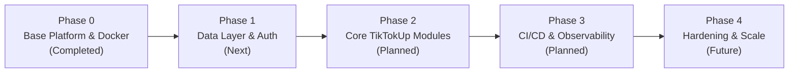

# Project Roadmap

Tài liệu này phác thảo lộ trình phát triển theo từng giai đoạn (Phases) của dự án **TikTokUp**, tách biệt rõ những hạng mục đã hoàn thành ở nền tảng gốc và kế hoạch mở rộng tiếp theo.

---

## Phase 0: Base Platform & Docker Infrastructure — `[Completed]`

**Mục tiêu**: Dựng bộ khung full-stack chuẩn mực, chạy hoàn toàn qua Docker, sẵn sàng phát triển tính năng ngay lập tức.

- [x] Khởi tạo Backend **Golang 1.26** (`net/http`, `log/slog`, Clean/Layered architecture, graceful shutdown).
- [x] Tích hợp **PostgreSQL 18** (`postgres:18-alpine`) trong Docker Compose với persistent volume, `pgx/v5` connection pool, live readiness probe và transactional SQL migration runner (`schema_migrations`).
- [x] Xây dựng Middleware chuẩn (`Recover`, `RequestID`, `Logger`, `CORS`) và JSON Response Envelope thống nhất.
- [x] Cung cấp các endpoint hệ thống (`/health`, `/api/v1/health`, `/api/v1/ready`, `/api/v1/info`) kèm bộ unit tests.
- [x] Khởi tạo Frontend **Next.js 16 + TypeScript + Tailwind CSS v4 + Shadcn UI v4** thông qua Docker.
- [x] Thiết lập 12 Shadcn UI core components, Dark/Light/System theme, App Router boundaries (`loading`, `error`, `not-found`) và **System Telemetry Dashboard** hiển thị live status của Go 1.26 + PostgreSQL 18.
- [x] Cấu hình **Nginx Reverse Proxy** (routing `/api/*` và `/*`, rate limiting, gzip, security headers, cache static, WebSocket HMR).
- [x] Hoàn thiện Docker Compose cho Production (`docker-compose.yml`), Dev Hot-reload (`docker-compose.dev.yml`), `.env.example` và `Makefile`.
- [x] Hoàn thiện bộ 7 tài liệu trong `docs/`, `README.md` và `AGENTS.md`.

---

## Phase 1: Auth, Domain Schemas & Core API Foundations — `[Next]`

**Mục tiêu**: Xây dựng lớp truy cập dữ liệu nghiệp vụ trên PostgreSQL 18, xác thực người dùng và tài liệu hóa API.

- [ ] **Domain Schemas & Repository Layer**: Mở rộng SQL migrations (`000002_*.sql` cho bảng `users`, `sessions`, `workspaces`) cùng tầng `internal/repository` và `internal/service`.
- [ ] **Authentication & RBAC**: Triển khai đăng ký/đăng nhập, JWT access/refresh token (HTTP-only cookie qua cùng origin Nginx), middleware xác thực và phân quyền vai trò (`admin`, `operator`, `viewer`).
- [ ] **Request Validation & OpenAPI**: Chuẩn hóa validate payload request và sinh đặc tả OpenAPI/Swagger cho API v1.
- [ ] **Frontend Auth Shell**: Trang Login/Register, bảo vệ route bằng Next.js middleware/layout, App Sidebar layout bằng Shadcn UI.

---

## Phase 2: Core Business Modules (TikTokUp Domain) — `[Planned]`

**Mục tiêu**: Triển khai các tính năng nghiệp vụ cốt lõi dựa trên yêu cầu chi tiết đã chốt với đội sản phẩm.

- [ ] **Workspace & Account Management**: Quản lý tài khoản/kênh, cấu hình kết nối API đối tác và phân quyền theo workspace.
- [ ] **Media Storage & Upload Pipeline**: Tích hợp Object Storage (MinIO cho local / S3 cho production) hỗ trợ upload file lớn qua presigned URL.
- [ ] **Background Jobs & Scheduling**: Thêm Redis + worker queue (Asynq / River) xử lý tác vụ bất đồng bộ, lập lịch và cơ chế retry.
- [ ] **Analytics & Reporting Dashboard**: Biểu đồ hiệu suất, bộ lọc đa chiều, phân trang server-side (`Shadcn DataTable`) và xuất báo cáo.

---

## Phase 3: Quality Automation, CI/CD & Observability — `[Planned]`

**Mục tiêu**: Tự động hóa kiểm thử, phát hành và nâng cấp khả năng giám sát vận hành.

- [ ] **CI Pipeline (GitHub Actions)**: Tự động chạy `go vet`, `go test -race`, `tsc --noEmit`, `eslint` và kiểm thử build Docker image trên mỗi Pull Request.
- [ ] **E2E & Integration Testing**: Thêm bộ kiểm thử E2E bằng Playwright chạy trong Docker kiểm chứng toàn trình UI → Nginx → API → DB.
- [ ] **Observability Stack**: Tích hợp Prometheus metrics (`/metrics`), OpenTelemetry tracing dựa trên `X-Request-ID` và dashboard Grafana.
- [ ] **CD Pipeline**: Tự động đóng gói, gắn tag semantic version, push container registry và deploy lên staging/production.

---

## Phase 4: Production Hardening & Scaling — `[Future]`

**Mục tiêu**: Tối ưu độ sẵn sàng cao, bảo mật chuyên sâu và khả năng chịu tải lớn.

- [ ] **HTTPS / TLS Automation**: Tự động cấp phát & gia hạn chứng chỉ SSL (Certbot / Caddy / Cloud LB) cùng HSTS và CSP headers chặt chẽ.
- [ ] **Security Auditing**: Quét lỗ hổng image định kỳ (`trivy`), dependency updates tự động, audit log cho các thao tác nhạy cảm.
- [ ] **High Availability & Scaling**: Hỗ trợ nhân bản nhiều replica backend/frontend sau load balancer, Redis-backed distributed rate limiting.
- [ ] **Backup & Disaster Recovery**: Thiết lập lịch backup database tự động và quy trình diễn tập khôi phục (restore drill).

---

## Bảng theo dõi tiến độ tổng quan

| Phase | Trọng tâm | Trạng thái | Phụ thuộc chính |
| :--- | :--- | :--- | :--- |
| **Phase 0** | Base Stack (Go 1.26, Next.js 16, Shadcn UI, Nginx, Docker, Docs) | **Completed** | Docker Engine & Compose |
| **Phase 1** | PostgreSQL, Migrations, Auth/RBAC, OpenAPI | Next | Hoàn tất Phase 0 |
| **Phase 2** | Domain Modules, Object Storage, Redis Queue, Analytics | Planned | Hoàn tất Phase 1 & chốt đặc tả BRD chi tiết |
| **Phase 3** | CI/CD, Playwright E2E, Prometheus/Grafana/OTel | Planned | Hoàn tất Phase 1–2 |
| **Phase 4** | TLS/Security Hardening, Scaling, Backup/DR | Future | Sẵn sàng triển khai Production công khai |
