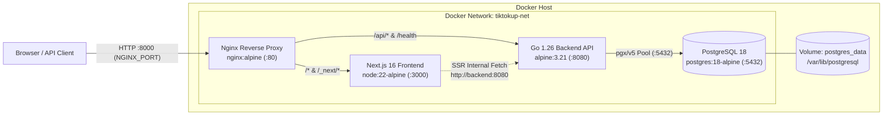
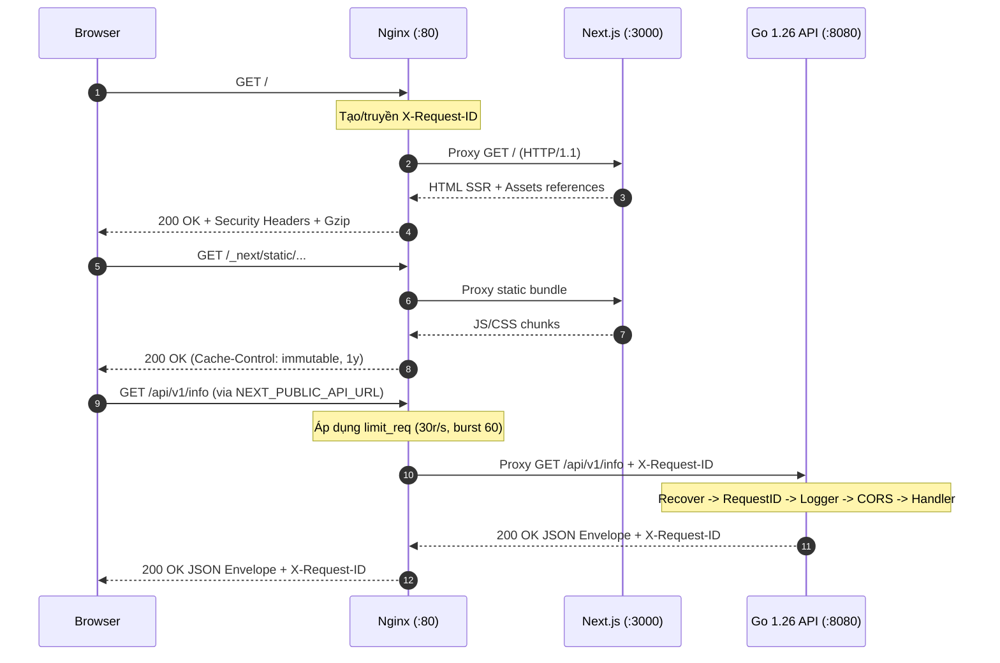
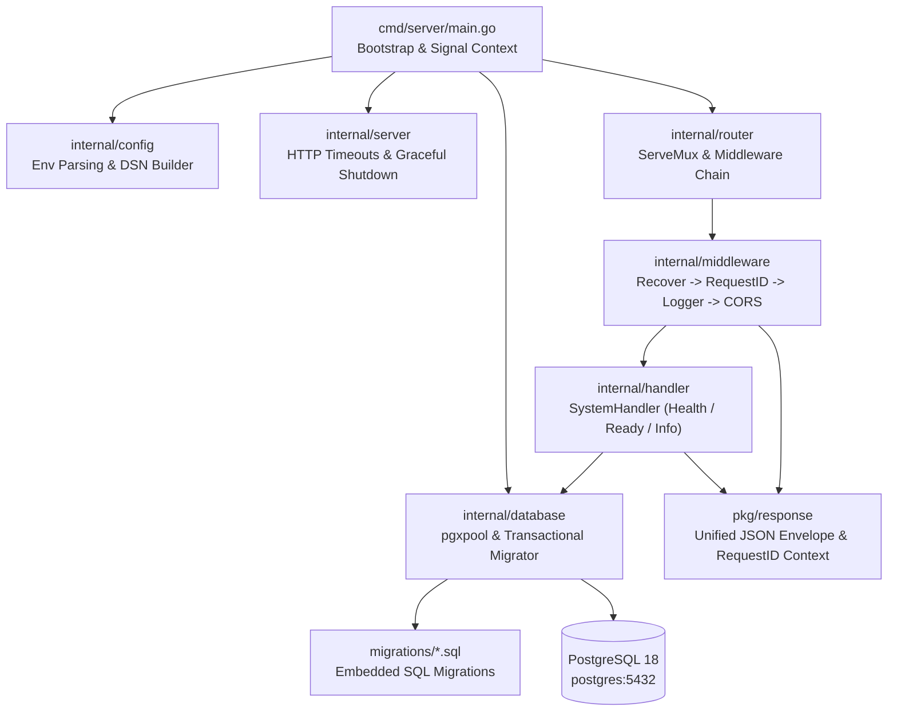
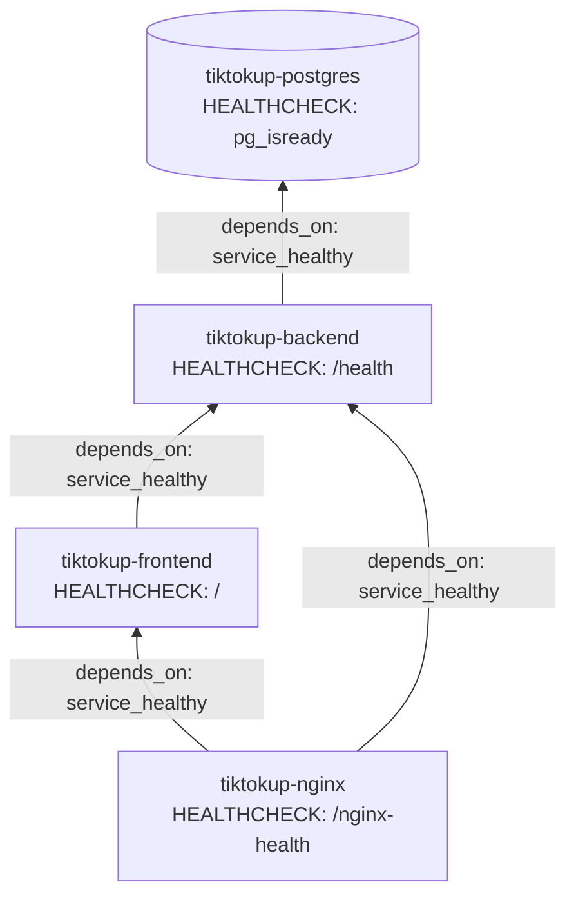

# System Architecture

## 1. Kiến trúc tổng thể (High-Level Architecture)

**TikTokUp** áp dụng mô hình **4-Container Reverse Proxy Architecture** chạy trên một Docker bridge network riêng biệt (`tiktokup-net`). Chỉ có container **Nginx** được mở cổng ra máy host; **Frontend (Next.js)**, **Backend (Go 1.26)** và **Database (PostgreSQL 18)** đều nằm hoàn toàn trong mạng nội bộ ở chế độ production.

### Nguyên tắc kiến trúc
1. **Single Origin Entrypoint**: Trình duyệt chỉ giao tiếp với một origin duy nhất (Nginx). Điều này loại bỏ hầu hết rắc rối về CORS và cookie cross-site khi triển khai thực tế.
2. **Internal Network Isolation**: Trong `docker-compose.yml`, `frontend`, `backend` và `postgres` chỉ khai báo `expose`, không bind port trực tiếp ra host (chỉ mở trong `docker-compose.dev.yml` khi cần debug hoặc kết nối DB client trực tiếp qua cổng `5433`).
3. **Dual API Path cho Next.js**:
   - **Browser (Client Component)** gọi `/api/v1/*` thông qua `NEXT_PUBLIC_API_URL=/api` → đi qua Nginx → `backend:8080`.
   - **Server (RSC / Route Handler)** gọi trực tiếp `INTERNAL_API_URL=http://backend:8080` qua mạng Docker nội bộ mà không cần vòng ra ngoài host.

---

## 2. Luồng xử lý Request (Request Lifecycle)

### 2.1. Luồng tải trang & gọi API kiểm tra sức khỏe

---

## 3. Thiết kế chi tiết từng thành phần

### 3.1. Edge Layer — Nginx (`nginx/`)
- **Upstream Keepalive**: Duy trì pool kết nối tái sử dụng (`keepalive 32`) tới `backend:8080` và `frontend:3000` giúp giảm overhead bắt tay TCP.
- **Định tuyến (Routing Table)**:
  - `= /nginx-health`: Trả JSON `200 OK` trực tiếp từ Nginx (tắt `access_log` để giảm nhiễu).
  - `= /health`: Proxy tới `backend:8080/health`.
  - `/api/`: Áp dụng rate limit `api_limit` (`30r/s`, `burst=60 nodelay`), proxy giữ nguyên path `/api/*` tới `backend:8080`.
  - `/_next/static/`: Proxy tới `frontend:3000` kèm header cache `public, immutable` (1 năm).
  - `/_next/webpack-hmr`: Bật WebSocket upgrade phục vụ Hot Module Replacement trong môi trường dev.
  - `/`: Proxy toàn bộ các route web tới `frontend:3000` có hỗ trợ WebSocket upgrade.
- **Bảo mật & Tối ưu**:
  - Tắt version banner (`server_tokens off`).
  - Gắn các security headers: `X-Frame-Options`, `X-Content-Type-Options`, `Referrer-Policy`, `Permissions-Policy`.
  - Nén Gzip level 5 cho text/JSON/JS/CSS/SVG từ 1KB trở lên.
  - Giới hạn kích thước body `client_max_body_size 50m`.
  - Access log chuẩn JSON (`main_json`) ghi nhận `request_id`, `request_time`, `upstream_time`.

### 3.2. Backend Layer — Golang 1.26 & PostgreSQL 18 (`backend/`)
Áp dụng kiến trúc phân lớp (Layered Architecture) theo Standard Go Project Layout, kết hợp thư viện chuẩn Go 1.26 (`net/http`, `log/slog`, `embed`) và `pgx/v5` (`pgxpool`) để giao tiếp PostgreSQL 18:

- **Thứ tự thực thi Middleware (ngoài vào trong)**:
  1. `Recover`: Bắt mọi panic ở tầng dưới, ghi stack trace qua `slog.ErrorContext`, trả về JSON `500 INTERNAL_SERVER_ERROR`.
  2. `RequestID`: Đọc `X-Request-ID` từ Nginx/client (hoặc sinh 16-byte random hex), gắn vào response header và `r.Context()`.
  3. `Logger`: Đo `duration_ms`, số byte và HTTP status; ghi log JSON qua `slog` (status `>=500` ở mức Error, `>=400` mức Warn, `/health` mức Debug, còn lại Info).
  4. `CORS`: Kiểm tra danh sách `CORS_ALLOWED_ORIGINS`, hỗ trợ preflight `OPTIONS` trả `204 No Content`.
- **HTTP Server Hardening (`internal/server/server.go`)**:
  - `ReadHeaderTimeout: 10s` (chống Slowloris), `ReadTimeout`, `WriteTimeout`, `IdleTimeout` cấu hình qua `.env`.
  - Graceful shutdown theo `SIGINT`/`SIGTERM` với deadline `SERVER_SHUTDOWN_TIMEOUT_SECONDS` (mặc định 10s).

### 3.3. Frontend Layer — Next.js 16 + TypeScript + Shadcn UI (`frontend/`)
- **App Router & Rendering**:
  - `RootLayout` (`src/app/layout.tsx`) nạp font Geist/Geist Mono, bọc `ThemeProvider` (`next-themes`), `Header`, `Footer` và `Toaster` (`sonner`).
  - Bật `output: "standalone"`, `cacheComponents: true`, `partialPrefetching: true` và `@tailwindcss/turbopack` trong `next.config.ts`.
  - Có đầy đủ các Next.js boundary chuẩn: `loading.tsx`, `error.tsx`, `not-found.tsx`.
- **API Client (`src/lib/api.ts`)**:
  - Typed wrapper `apiFetch<T>()` tự động chọn `INTERNAL_API_URL` (khi chạy server-side) hoặc `NEXT_PUBLIC_API_URL` (khi chạy client-side).
  - Đo latency request, đọc `X-Request-ID`, parse `ApiEnvelope<T>` khớp 1-1 với `backend/pkg/response/json.go`.
- **UI Architecture**:
  - Shadcn UI v4 (`style: "base-nova"`) xây dựng trên `@base-ui/react`, styling bằng Tailwind CSS v4 CSS variables (OKLCH).

---

## 4. Kiến trúc Container & Healthcheck Dependencies

- **PostgreSQL 18 Persistence**: Image `postgres:18-alpine` khai báo `PGDATA=/var/lib/postgresql/18/docker` và volume chuẩn `/var/lib/postgresql`, do đó `docker-compose.yml` mount named volume `postgres_data:/var/lib/postgresql` đảm bảo dữ liệu bền vững qua các lần rebuild/restart.
- **Multi-stage Dockerfiles**:
  - `backend/Dockerfile`: `base` (`golang:1.26-alpine`) → `dev` (cài `air`) / `builder` (`CGO_ENABLED=0`, build cả `/out/server` và `/out/migrate`) → `production` (`alpine:3.21`, non-root `appuser`).
  - `frontend/Dockerfile`: `base` (`node:22-alpine`) → `deps` (`npm ci`) → `dev` (`next dev`) / `builder` (`next build`) → `production` (`node:22-alpine`, non-root `nextjs`, chỉ copy `.next/standalone`, `.next/static`, `public`).
  - `nginx/Dockerfile`: `nginx:alpine`, copy `nginx.conf` và `conf.d/default.conf`, cài đặt `HEALTHCHECK`.

---

## 5. Định hướng mở rộng kiến trúc (Future Evolution)

Khi phát triển tiếp các tính năng nghiệp vụ, kiến trúc hiện tại mở rộng trực tiếp mà không phá vỡ thiết kế ban đầu:
- **Domain Data Access**: Bổ sung `internal/repository` và `internal/service` sử dụng `db.Pool` (`*pgxpool.Pool`) cùng các file SQL migration kế tiếp (`000002_*.sql`).
- **Async Workers & Cache**: Thêm `redis` cho session/rate-limit phân tán và job queue (xử lý upload/lập lịch TikTok).
- **Object Storage**: Tích hợp S3 / MinIO cho lưu trữ video/ảnh thông qua presigned URL.
- **Observability**: Gửi JSON logs sang Loki/ELK và thêm OpenTelemetry SDK gắn liền với `X-Request-ID`.
